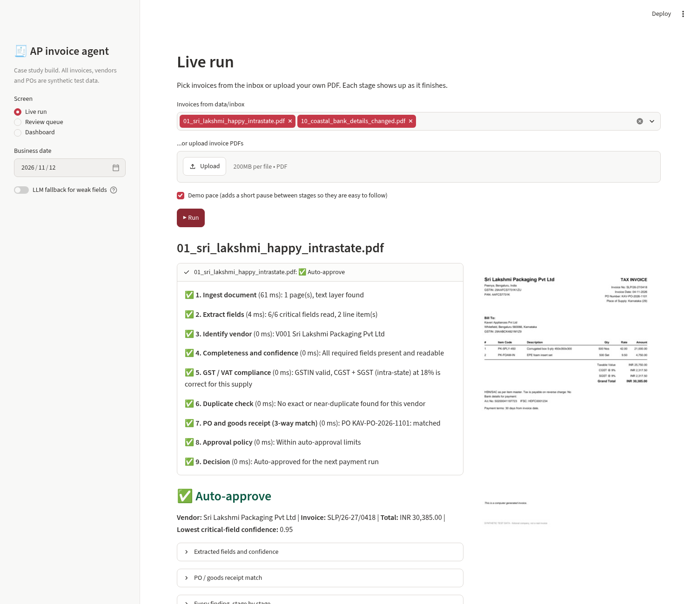
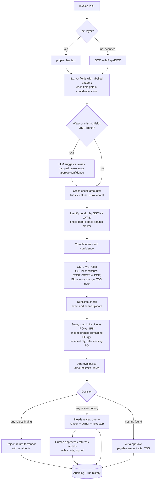

# AP invoice agent: from vendor PDF to a reasoned decision

Case study for the Zamp AI Solutions Analyst role, problem statement PS-1 (invoice processing).

The process takes a vendor invoice PDF, reads it, checks it against the vendor master, the purchase
order and the goods receipt, and ends with one of three decisions: **auto-approve**, **needs review**
(with the reason and the person who should look at it) or **reject and return to the vendor**.
Every step is shown while it runs and written to an audit log.

> **All data in this repo is synthetic.** The companies, GSTINs, VAT IDs, bank accounts, POs and
> invoices were made up by me for testing. The GSTINs carry a valid checksum so the checksum rule
> can be tested properly, but they do not belong to anyone.



---

## 1. The problem and why I picked it

An AP clerk opens each invoice, finds the PO in a spreadsheet, checks that prices and quantities
line up with what was ordered and what the warehouse received, checks the tax, and decides. Most
invoices are fine. The time goes into the ones that are not, and the expensive mistakes happen on
the ones that look fine but are not: a re-issued invoice under a new number, a bank account that
quietly changed, a vendor billing the rest of a PO twice.

I picked PS-1 because the inputs are concrete (a PDF and some tables), the rules are real and
checkable, and a wrong answer costs actual money. That makes it easy to say what "correct" means
and to measure it. I also wanted to work with Indian GST invoices, because the tax logic there
(CGST + SGST inside a state, IGST across states, GSTIN checks, TDS) is where a lot of the manual
checking happens in Indian AP teams. I added a few EU invoices so the same process has to handle
a second tax system and a second number format.

**Assumed setup.** The buyer is a fictional appliance maker with an Indian entity in Bengaluru
(Kaveri Appliances Pvt Ltd, Karnataka) and a German entity in Berlin (Kaveri Appliances GmbH).
Invoices arrive as PDFs. Procurement keeps a vendor master, a PO register and goods receipts (GRN,
or a service entry sheet for services). AP keeps a ledger of invoices already booked. I wrote down
every other assumption in [DECISIONS.md](DECISIONS.md).

## 2. How it works



Each stage produces **findings** with one of three severities:

| Severity | Meaning | Example |
|---|---|---|
| reject | Only the vendor can fix it, so it goes back to them | IGST charged on an intra-state supply |
| review | Someone in our company has to decide | Invoice bills more than the warehouse received |
| info | Recorded, does not stop approval | TDS to deduct at payment, price 1% over PO but inside tolerance |

The decision rule is simple on purpose: any reject finding means reject, otherwise any review finding
means review, otherwise auto-approve. The reasons travel with the decision, and every review reason
names an owner (procurement, warehouse, treasury, finance manager, tax) and a next step.

## 3. The edge cases

The brief asks for 2 to 4 edge cases of my own. These are the four I built the process around,
because each one is a real way money leaks out of AP and none of them shows up if you only read the
invoice on its own:

| # | Edge case | What the process does | Files |
|---|---|---|---|
| 1 | **Split PO, over-billed.** A vendor bills a PO in parts. 1,500 of 2,000 cartons were already billed; the new invoice bills 700. | Keeps a running count of billed quantity per PO line from the ledger and from earlier invoices in the same run. Flags 200 over, suggests paying 500. The honest final part of a different split PO (400 of the last 400) goes through. | 04, 05 |
| 2 | **Re-issued invoice under a new number.** October housekeeping was already approved as MFS-1042; MFS-1043 arrives 3 days later for the same amount, PO and service period. | Exact duplicates (after normalising "NCS/INV/2026/0088" style numbers) are rejected. Near-duplicates are scored on amount, date window, number similarity, PO and service period, and go to review. A normal next-month invoice with the same amount does **not** trigger it, because the service period differs. | 06, 07 |
| 3 | **GST that looks right but is wrong.** A Karnataka vendor charges IGST to a Karnataka buyer; another vendor's GSTIN has a one-character typo. | Checks the GSTIN format, state code and checksum, and compares supplier state with place of supply to decide CGST + SGST vs IGST. Both go back to the vendor, because input tax credit is at risk and only the vendor can reissue. The EU version is the same idea: a Dutch vendor charging 21% VAT to the German entity instead of reverse charge. | 08, 09, 16 |
| 4 | **Bank details changed on the invoice.** Everything matches except the account number and IFSC. | Never auto-approves. Sends it to the AP lead / treasury with the instruction to call the vendor on the number already in the master, not the one on the invoice. | 10 |

Other cases in the sample set: short receipt against the GRN (11), unit price 8% over PO with a 2%
tolerance (12), no PO number on the invoice, so the process infers the only open PO that fits (13), a
scanned image-only invoice read by OCR (14), a messy bill with no invoice number and a lump-sum line
(15), a vendor not in the master (17), and a clean invoice above the INR 5 lakh auto-approval limit (18).

## 4. Results on the sample set

`python run.py` on the 18 synthetic invoices:

| Route | Count | Files |
|---|---|---|
| Auto-approve | 6 | 01, 02, 03, 04, 13, 14 |
| Needs review | 7 | 05, 07, 10, 11, 12, 17, 18 |
| Reject, return to vendor | 5 | 06, 08, 09, 15, 16 |

`python eval.py --scanned` compares the output with a ground-truth file I wrote by hand
(`data/ground_truth.json`, expected values and routes decided before running the pipeline):

| Test | Routing correct | Field accuracy (11 fields x 18) | Auto-approved when it should not have been |
|---|---|---|---|
| Clean PDFs | 18 / 18 | 198 / 198 | 0 |
| All 18 as degraded scans, seed 11 (I used this one to fix the parser) | 16 / 18 | 196 / 198 (99.0%) | 0 |
| All 18 as degraded scans, seed 29 (held out, run once after the fixes) | 13 / 18 | 192 / 198 (97.0%) | 0 |

How I read these numbers:

* The clean result only shows the rules do what I designed them to do. I wrote the data and the
  rules, so 100% there is expected and does not say much about real invoices.
* The scan test is the more useful one. On the held-out run every mistake went the safe way: 4 of the
  6 clean invoices were sent to a person (low OCR confidence or amounts that did not reconcile), and
  one reject became a review. None was approved wrongly. On real data I would expect the touchless
  rate to drop like this before it rises, and that is the right order.
* **The first scan test failed in a way that mattered.** It auto-approved the re-issued invoice (07)
  because OCR read "Oct2026" instead of "Oct 2026", so my duplicate check thought the service periods
  were different. It also rejected two clean invoices as "missing invoice number" when OCR had simply
  missed the label. I fixed both: periods are normalised before comparing, and a field missing on a
  scan now goes to review instead of back to the vendor, because on a scan you cannot tell "vendor
  left it out" from "OCR missed it". The original report is kept in
  [docs/eval_first_stress_run.md](docs/eval_first_stress_run.md).

The tests (`pytest`, 38 tests) cover each rule on its own, the full sample set end to end, the LLM
fallback with a fake model, and a smoke test of every UI screen.

## 5. How to run it

Needs Python 3.11+ (built on 3.13). No API key, no system packages on a normal laptop, no network after install.

```bash
python3 -m venv .venv && source .venv/bin/activate
pip install -r requirements.txt

python scripts/generate_samples.py   # (re)create the synthetic invoices and master data
python run.py                        # process data/inbox end to end, prints every stage live
python run.py data/inbox/10_coastal_bank_details_changed.pdf   # one invoice
streamlit run app.py                 # UI: live run, review queue, dashboard
python eval.py --scanned             # accuracy report -> outputs/eval_report.md
python -m pytest -q                  # 38 tests
```

To host the UI on Streamlit Community Cloud, the main file is `app.py`. In Advanced settings
pick Python 3.13 (the version I built on). No secrets are needed. `packages.txt` lists a couple of
system libraries that ONNX Runtime needs on that host.

Optional LLM fallback: `export LLM_API_KEY=...` (any OpenAI-compatible endpoint, see
`ap_agent/llm.py`), then `python run.py --llm` or switch it on in the UI sidebar.

Business date: date checks use `--as-of` (default 2026-11-12) so results do not change with the
day you run it.

## 6. What you get

| Output | Where |
|---|---|
| Decision per invoice with reasons, owner and next step | console, UI, `outputs/<run>/summary.xlsx` |
| Review queue and return-to-vendor list | sheets in `summary.xlsx`, Review queue screen |
| Every field with value, confidence and how it was read | `Field confidence` sheet, UI |
| Full result per invoice (fields, lines, PO match, all findings) | `outputs/<run>/decisions/*.json` |
| Short run report | `outputs/<run>/run_report.md` (`outputs/latest` points to the newest run) |
| Audit log of every stage and every human decision | `outputs/audit_log.jsonl`, `outputs/ap_agent.db` |
| Accuracy report | `outputs/eval_report.md` |
| Sample run report and summary, so you can read the output without running it | `docs/sample_run/` |

## 7. Design decisions in short

The full list with reasons is in [DECISIONS.md](DECISIONS.md). The main ones:

1. **Rules first, LLM optional.** The rules are free, fast, deterministic and every value can be traced
   to a line of the PDF. The LLM is only asked about weak fields, its answers are scored below the
   auto-approve bar, and they still pass through every rule. It can suggest; it cannot approve money.
2. **Confidence comes from cross-checks, not just from the reader.** A labelled read starts at 0.95,
   OCR is scaled by the OCR engine's own score for that line, and amounts move up when lines, net, tax
   and total agree with each other, and down when they do not. Anything critical under 0.85 goes to a
   person.
3. **Reject only what the vendor must fix.** Wrong tax head, bad GSTIN, missing invoice number, foreign
   VAT on a reverse-charge supply. Everything that needs our own judgement is review, with an owner.
4. **Bias to review, measured.** The number I watch first is "auto-approved when it should not have
   been". I would rather send a good invoice to a person than pay a bad one.
5. **Thresholds in one file** (`ap_agent/config.py`): price tolerance 2%, approval limit INR 5 lakh /
   EUR 10,000, confidence 0.85, duplicate window 20 days. An AP lead should be able to read and change
   them without touching the logic.

## 8. What it does not handle yet

* Real vendor layouts. My parser is built on labelled fields and was tested on five invoice templates
  I made. Real invoices will break some patterns on day one; that is what the LLM fallback and the
  review queue are for, but I have not measured it on real data.
* E-invoice QR codes. Indian B2B invoices above the e-invoicing threshold carry a signed QR with the
  IRN, GSTINs and totals. Reading and verifying that QR would be more reliable than OCR. Not built.
* Live GSTIN status (GSTN API), GSTR-2B matching for input tax credit, and VIES checks for EU VAT IDs.
  I only check format and checksum.
* Credit notes, partial approvals (it suggests the partial amount but does not split the invoice),
  multi-page invoices with tables across pages, foreign-currency invoices on an INR PO, and
  quantities in different units than the PO.
* Freight or other charges not on the PO are flagged as "line not on PO"; there is no rule yet for
  "accept freight up to X".
* TDS rates come from the vendor master. I do not decide which section applies; that is the tax
  team's call.
* No email intake, no ERP connection, no login or roles in the UI.
* Approved invoices are not written back to the AP ledger file, so each run starts from the same
  history. That keeps the demo repeatable; in production approvals would post to the ledger.

## 9. What I would do in week 2 with a real customer

Week 1 would be sitting with the AP team and watching them work. Week 2 is about getting the process
onto their real invoices without it touching anything yet:

1. **Get real ground truth.** Export the last two or three months of invoices together with what AP
   actually did with each one (paid, held, sent back, and why). That replaces my synthetic ground truth
   and tells me which exceptions really happen and how often.
2. **Run in shadow mode.** The process reads every new invoice and makes its decision, but nothing is
   posted. Each day I compare its decisions with the team's and go through every disagreement with the
   AP lead. Disagreements are either a bug, a missing rule, or a rule that only lives in someone's head.
3. **Write down the unwritten rules.** Things like "freight from this transporter is never on the PO",
   "this vendor always bills monthly services on the 1st", or "anything over 2 lakh needs the plant
   head". These become config, not code.
4. **Connect read-only to their systems** (vendor master, open POs, GRNs, AP ledger) so the matching
   uses live data, and start with their top vendors by volume, since a few vendors usually make up most
   of the invoices.
5. **Agree on the numbers we will watch together:** share of invoices that go through without a
   person, false auto-approvals (target zero before anything goes live), time an invoice waits in each
   queue, and the top reasons invoices stop. I would not promise a touchless rate before seeing their
   data.

## 10. What I would build next for production

* Mailbox intake (forward-to-AP address), with attachments split per invoice.
* E-invoice QR verification and GSTN/VIES lookups.
* Vendor-specific extraction profiles learned from corrections in the review screen, and an LLM with
  vision for the long tail of layouts, still behind the same rules.
* Partial approval and credit note handling, and a proper approval matrix by amount and cost centre.
* Posting approved invoices to the ERP and payment run, with roles, login and a tamper-evident audit log.
* Monitoring per vendor: extraction confidence, review rate, and reasons over time, so a vendor that
  changes its invoice format shows up the same week.

## 11. Project layout

```
run.py                  one-command batch run (CLI, live stage output)
app.py                  Streamlit UI: live run, review queue, dashboard
eval.py                 accuracy report against ground truth, plus OCR stress test
ap_agent/
  config.py             thresholds and buyer entities
  extract.py            reading (text layer or OCR) and field extraction with confidence
  llm.py                optional LLM fallback for weak fields
  taxids.py             GSTIN checksum, EU VAT ID formats
  rules.py              vendor, completeness, GST/VAT, duplicates, 3-way match, policy
  pipeline.py           runs the stages, makes the decision
  masterdata.py         vendor master, POs, GRNs, AP ledger
  store.py              SQLite run history, review actions, audit log
  report.py             Excel, CSV, JSON and markdown outputs
scripts/generate_samples.py   builds the synthetic invoices, master data and ground truth
data/                   vendor_master.csv, purchase_orders.csv, goods_receipts.csv, ap_ledger.csv,
                        ground_truth.json, inbox/*.pdf (all synthetic)
tests/                  38 pytest tests
docs/                   screenshots, first stress-test report, one-page summary
```

Built by Abhiram Ramakrishnan. I used AI coding tools heavily while building it, as the brief
encourages. I chose the problem and the edge cases, reviewed every rule and trade-off, and can walk
through any part of the code.
